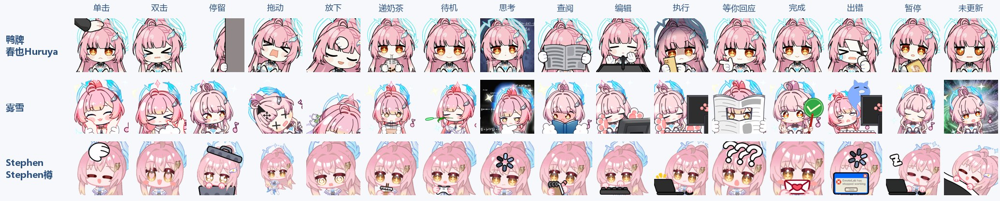

  

# Aemeath Companion · DeepSeek Harness full-program plugin

**Aemeath from *Wuthering Waves* keeps you company in DeepSeek Harness: her expression follows your task, and she answers in her own voice.**

[中文](README.md) · [Issues](https://github.com/Doya16/dsh-aemeath/issues)

The plugin runs the same program as the [Aemeath DeepSeek desktop pet](https://github.com/Doya16/aemeath-deepseek-pet) full package: three expression presets (鸭牌, 雾雪, Stephen), 90 subtitled Aemeath voice lines, the balance box and per-turn cost float, and import of Aemeath sticker packs downloaded from 呜哇小站. The plugin downloads, starts and connects the program; no separate connection plugin is needed.

**Requirements:** Windows 10 (1809 or later) / 11 x64 with a local DeepSeek Harness. The first start downloads the full program (about 186 MiB); no Python needed.

## Getting started

1. Install and sign in to [DeepSeek Harness](https://www.deepseek.com/harness/).
2. Install and enable `dsh-aemeath` in Harness's plugin manager.
3. Click **爱弥斯桌宠 → 下载并安装完整版** at the bottom right. Download source: automatic, GitHub, or a mirror for mainland China.
4. Click **启动桌宠**. Right-click the pet → **设置…**, or **打开完整设置** in the plugin entry.

After the pet has started once, the entry hides itself; manage it later under **Harness settings → 爱弥斯桌宠**. Aemeath's entry sits higher than other pet plugins' entries, so they don't overlap. Don't run the plugin and the full package at the same time.

## Presets and more sticker packs

| Preset | Artist |
| --- | --- |
| **Stephen** (default) | Stephen樽 |
| **鸭牌** | 春也Huruya |
| **雾雪** | 雾雪 |

Switch under **Settings → 桌面与声音 → 表情预设**. More packs: **Settings → 交互工作室 → GIF 素材 → 前往下载** opens [呜哇小站](https://emoji.wuwa.games/archives?character=爱弥斯); click **打包下载全部** on a pack's page, then **导入下载好的压缩包…** or drop the zips onto the window. Imports are grouped by artist → pack and kept when the plugin is updated or removed. The plugin never bundles or downloads the site's stickers itself; ask the site owner and the artists before redistributing them.

## Credits

Stickers: artists' work collected on [呜哇小站](https://emoji.wuwa.games/) — **鸭牌** by 春也Huruya, **雾雪** by 雾雪, **Stephen** by Stephen樽. Voice lines are Aemeath's character voice from *Wuthering Waves*. Characters, sticker images and original voices belong to their respective owners (*Wuthering Waves* © Kuro Games). This is an unofficial fan project, not affiliated with Kuro Games or 呜哇小站; stickers are for personal, non-commercial use only.

Code: [MIT](LICENSE). See [CREDITS.txt](CREDITS.txt), [desktop/THIRD_PARTY.txt](desktop/THIRD_PARTY.txt), [data and runtime notes](docs/SECURITY.md) and the [validation record](docs/VALIDATION.md).
