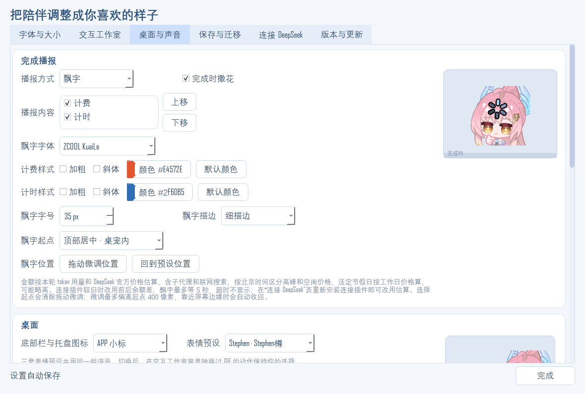
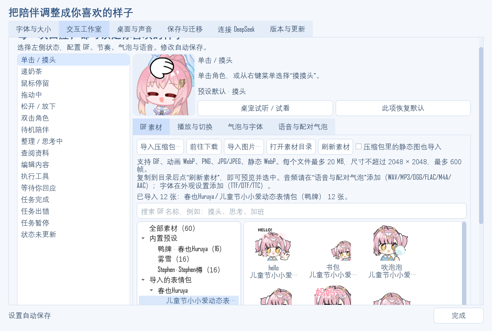

<div align="center">
  

# 爱弥斯桌宠 · DeepSeek Harness 完整版插件

**《鸣潮》爱弥斯陪你使用 DeepSeek Harness：跟随任务切换表情，用她的声音回应你。**

[English](README.en.md) · [问题反馈](https://github.com/Doya16/dsh-aemeath/issues)


</div>

插件版的桌宠程序与 [爱弥斯 DeepSeek 桌宠](https://github.com/Doya16/aemeath-deepseek-pet) 完整包相同：三套表情预设（鸭牌、雾雪、Stephen）、90 条带字幕的爱弥斯语音、余额框与本轮花费飘字，还能导入呜哇小站下载的爱弥斯表情包。插件负责下载、启动和连接 Harness，不需要另装连接插件。

**使用条件：** Windows 10（1809 及以后）/ 11 x64、本机 DeepSeek Harness。首次启动时下载完整程序（约 186 MiB），无需安装 Python。

## 开始使用

1. 安装并登录 [DeepSeek Harness](https://www.deepseek.com/harness/)。
2. 在 Harness 的插件管理中安装并启用 `dsh-aemeath`。
3. 点击窗口右下角 **爱弥斯桌宠 → 下载并安装完整版**。下载来源可选自动、GitHub 或镜像加速（中国大陆网络）。
4. 点击 **启动桌宠**。右键桌宠 → **设置…**，或从插件入口点击 **打开完整设置**。

完整包版用户迁入：在完整包版「设置 → 保存与迁移」导出配置素材 ZIP，再在插件版的同一位置导入。两者不要同时运行，否则会出现两只桌宠。

首次安装并成功启动桌宠后，右下角的部署面板和「爱弥斯桌宠」按钮会自动隐藏；以后在 **Harness 设置 → 爱弥斯桌宠** 启动、关闭、打开完整设置或更新完整版，也可以恢复入口。爱弥斯的入口按钮比其他桌宠插件的入口更高，同时启用时不会叠在一起。

## 三套表情预设

| 预设 | 画师 | 来源合集 |
| --- | --- | --- |
| **Stephen**（默认） | Stephen樽 | 爱弥斯·演唱会捏捏动态表情包（大寸）等捏捏表情包 |
| **鸭牌** | 春也Huruya | 爱弥斯动态表情包（鸭牌） |
| **雾雪** | 雾雪 | 爱弥斯动态表情包（雾雪）、日服生日会、围巾冬装、慵懒情侣衫、家居服、古风 |

每套预设给 16 种交互配好了 16 张互不相同的表情；在 **设置 → 桌面与声音 → 表情预设** 切换，三套预设共用同一组语音。



## 更多表情包：从呜哇小站导入

1. **设置 → 交互工作室 → GIF 素材**，点 **前往下载**，在 [呜哇小站](https://emoji.wuwa.games/archives?character=爱弥斯) 打开喜欢的合集，点 **打包下载全部**。
2. 点 **导入下载好的压缩包…**（可以一次选多个），或者直接把压缩包拖进设置窗口。
3. 导入的表情按 **画师 → 合集** 分组；点缩略图即可绑定到当前动作，合集可以删除。

| 还没导入时 | 导入之后 |
| --- | --- |
|  |  |

静态图和不是爱弥斯的图片默认跳过；和预设相同、或已经导入过的图片不会重复复制。导入的表情包保存在插件数据目录里，更新、卸载插件都不会删除。插件和桌宠不附带、也不会自动下载站内的表情包；表情包版权归各画师，转载或二次分发请先联系站长和画师。

## 陪伴、提醒与更新

- 任务进行时，表情依次切换为思考、查阅、编辑、执行、等你回应；结束时显示完成、出错或暂停。台词一旦开始就会说完。
- 底部余额框显示账户余额，点击刷新；任务完成时飘出本轮花费和用时，并撒彩色纸屑。
- 贴边藏起、全屏隐藏、每日小结、喝水和久坐提醒、点击穿透的顶部小锁。
- 桌宠内一键更新：只更新程序文件，保留表情、语音、导入的表情包和全部设置；更新清单由发布者离线密钥签名（Ed25519），签名不对就不会安装。

## 适用范围与说明

- 面向 **Windows 10/11 x64 本机 DeepSeek Harness**；普通 DeepSeek 聊天网页、macOS、Linux 和远程服务器不在支持范围。
- 插件读取了哪些数据、下载和运行了什么，见 [数据与运行说明](docs/SECURITY.md)；本版的测试范围见 [验证记录](docs/VALIDATION.md)。
- 首次下载完整程序后校验固定的 SHA-256；npm 包只有连接、下载和启动入口，约 0.3 MB。

## 素材来源与致谢

表情包来自 [呜哇小站](https://emoji.wuwa.games/) 收录的画师作品：**鸭牌** —— 春也Huruya；**雾雪** —— 雾雪；**Stephen** —— Stephen樽。感谢各位画师，也感谢呜哇小站整理收录。桌宠的 设置 → 版本与更新 → **关于与致谢** 里列出每套预设用到的合集，以及你导入的表情包的画师。

角色语音来自《鸣潮》爱弥斯的角色语音。角色、表情包图片与原版语音的权利归各自权利人所有（《鸣潮》© 库洛游戏）。本项目为个人制作的同人作品，与库洛游戏和呜哇小站无关；表情包仅供个人、非商业使用，请勿倒卖或用于付费分发。

程序代码采用 [MIT](LICENSE)；角色、表情包、语音与字体遵循各自的许可，详见 [素材说明](CREDITS.txt) 和 [第三方说明](desktop/THIRD_PARTY.txt)。

## 开发与验证

完整环境、源码提交记录、打包产物及发布校验见 [构建说明](docs/BUILD.md)。

```powershell
npm test
python -m pip install -r desktop/tools/requirements-build.txt
cd desktop
python -m unittest discover -s tests
cd ..
python desktop/tools/build_portable.py
python tools/package-runtime.py
npm pack
```

`desktop/` 是完整版源代码和默认素材；`lib/` 是 Harness 连接与启动入口。上游版本记录在 [UPSTREAM.json](desktop/UPSTREAM.json)。构建出的程序和 ZIP 不提交到 Git，发布为 Release 附件。
