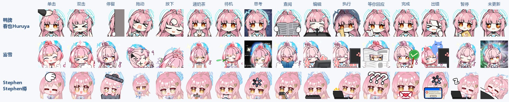
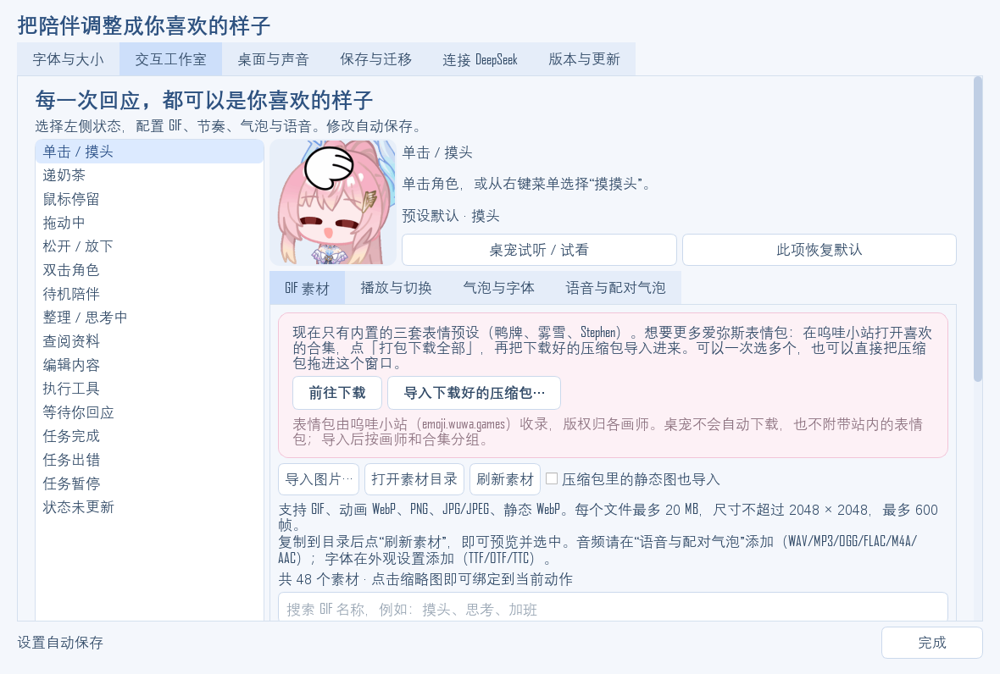
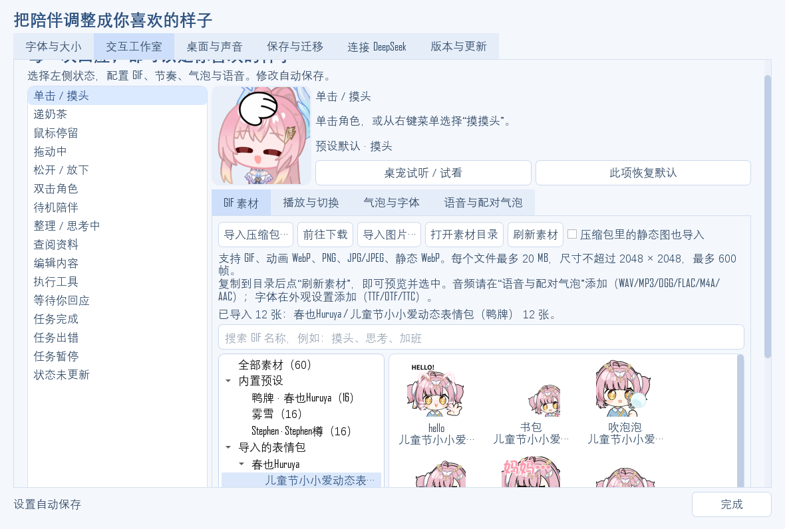

<!-- README language switch -->
[](README.md) [](README.en.md)
<!-- /README language switch -->

<div align="center">

# Aemeath DeepSeek Desktop Pet

**Aemeath from *Wuthering Waves* keeps you company in the official DeepSeek Harness desktop client: her expression follows your task, and she answers in her own voice.**

[Download for Windows](https://github.com/Doya16/aemeath-deepseek-pet/releases/latest) · [Usage guide (Chinese)](docs/USAGE.md) · [Issues](https://github.com/Doya16/aemeath-deepseek-pet/issues) · [中文](README.md)



</div>

Aemeath changes expression while a **DeepSeek Harness** task runs, answers with a voice line and a subtitle bubble when it finishes, and floats what the turn cost and how long it took. Below her, a box shows your account balance.

For **Windows 10/11 x64**. The full package ships **three expression presets (鸭牌, 雾雪, Stephen), 90 subtitled Aemeath voice lines** and two fonts and the Harness connection plugin. More Aemeath sticker packs can be downloaded from [呜哇小站](https://emoji.wuwa.games/archives?character=爱弥斯) and imported in one step. No Python needed.

## Install

**Requirements**: Windows 10 (1809 or later) or Windows 11, 64-bit, with the official **DeepSeek Harness** desktop client installed, signed in and opened once.

1. Download **Aemeath-DeepSeek-Windows-v1.0.0.zip** from [Releases](https://github.com/Doya16/aemeath-deepseek-pet/releases/latest).
2. Extract it into its own folder (Explorer "Extract All", or 7-Zip "Extract to Aemeath-DeepSeek-Windows-v…\"). The zip has no top-level folder. Don't extract into `C:\Program Files`.
3. Double-click **一键部署.cmd** in the extracted folder. It checks the files, asks you to quit Harness from the tray and installs the Harness connection plugin `dsh-aemeath-pet` (type `S` to skip it for now), creates desktop and Start menu shortcuts and starts Aemeath.
4. Right-click the pet → **设置 (Settings)**: pick the session to follow under **连接 DeepSeek**, switch the expression preset under **桌面与声音**, change expressions and voice lines in **交互工作室**.

If SmartScreen shows "Windows protected your PC", click "More info" → "Run anyway": the program has no paid code-signing certificate. Every release lists SHA256SUMS. New versions are offered inside the pet: **更新并重启爱弥斯** updates and restarts, keeping your settings and material.

## Three expression presets

| Preset | Artist | Packs |
| --- | --- | --- |
| **Stephen** (default) | Stephen樽 | 爱弥斯·演唱会捏捏动态表情包（大寸） and other 捏捏 packs |
| **鸭牌** | 春也Huruya | 爱弥斯动态表情包（鸭牌） |
| **雾雪** | 雾雪 | 爱弥斯动态表情包（雾雪）, birthday, winter scarf, couple shirt, home wear and 古风 packs |

Each preset gives the 16 interactions 16 different stickers. Switch under **Settings → 桌面与声音 → 表情预设**; all presets share one set of voice lines, and an interaction you changed by hand keeps your choice.

## More sticker packs from 呜哇小站

1. **Settings → 交互工作室 → GIF 素材** → **前往下载** opens the site; on a pack's page click **打包下载全部**.
2. Click **导入下载好的压缩包…** (several at once), or drop the zips onto the settings window.
3. Imported stickers are grouped by **artist → pack**; click one to bind it to the selected interaction.

Images are recognised by content (artist, pack, clean name, e.g. `001-XXS01_喇叭.gif` becomes 喇叭); new packs take the zip name. Static images and other characters are skipped by default; copies of the presets or of earlier imports are not copied again. Imports live in `assets/imported/`, which updates never touch, and a pack can be deleted from the picker. The pet never bundles or downloads the site's stickers itself; the stickers belong to their artists, so ask the site owner and the artists before redistributing them.

| Before importing | After importing |
| --- | --- |
|  |  |

## Voice, tasks and desktop

- **90 Aemeath voice lines** with subtitles, matched to the 16 interactions. A line that has started is always said in full.
- Follows Harness tasks (thinking, reading, editing, running tools, waiting for you, done, error, paused); several sessions' completions queue up; the balance box refreshes on a click; the done float shows the turn's estimated cost and time.
- Done float and confetti, edge docking, full-screen hide, daily recap, drink-and-stretch reminder, click-through lock.
- The Windows volume mixer shows 「爱弥斯 · DeepSeek」.
- Signed one-click updates (Ed25519); source GitHub or a mirror for mainland China.

## Credits

Stickers: artists' work collected on [呜哇小站](https://emoji.wuwa.games/) — **鸭牌** by 春也Huruya, **雾雪** by 雾雪, **Stephen** by Stephen樽. Thank you to the artists and to the site. **Settings → 版本与更新 → 关于与致谢** lists every pack the presets use and the artists of the packs you imported.

Voice lines are Aemeath's character voice from *Wuthering Waves*. Characters, sticker images and original voices belong to their respective owners (*Wuthering Waves* © Kuro Games). This is an unofficial fan project, not affiliated with Kuro Games or 呜哇小站. Stickers are for personal, non-commercial use only. See [assets/CREDITS.txt](assets/CREDITS.txt) and [THIRD_PARTY.txt](THIRD_PARTY.txt).

<details>
<summary>Run from source</summary>

Python 3.12:

```powershell
python -m venv .venv
.\.venv\Scripts\python.exe -m pip install -r requirements.txt
.\.venv\Scripts\python.exe -m aemeath_pet
```

Portable build: `pip install -r tools/requirements-build.txt`, then `python tools/build_portable.py` (output in `dist/爱弥斯DeepSeek桌宠/`). Tests: `python -m unittest discover -s tests`.

</details>
