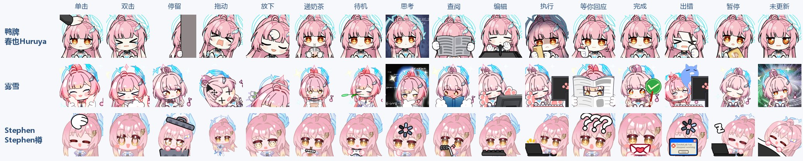
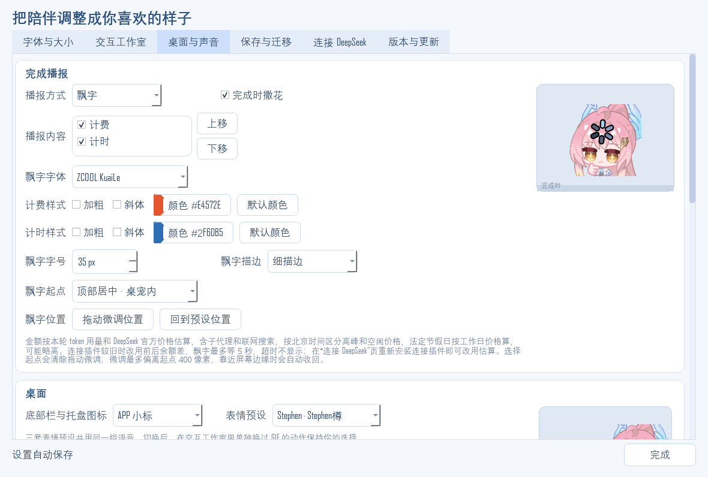
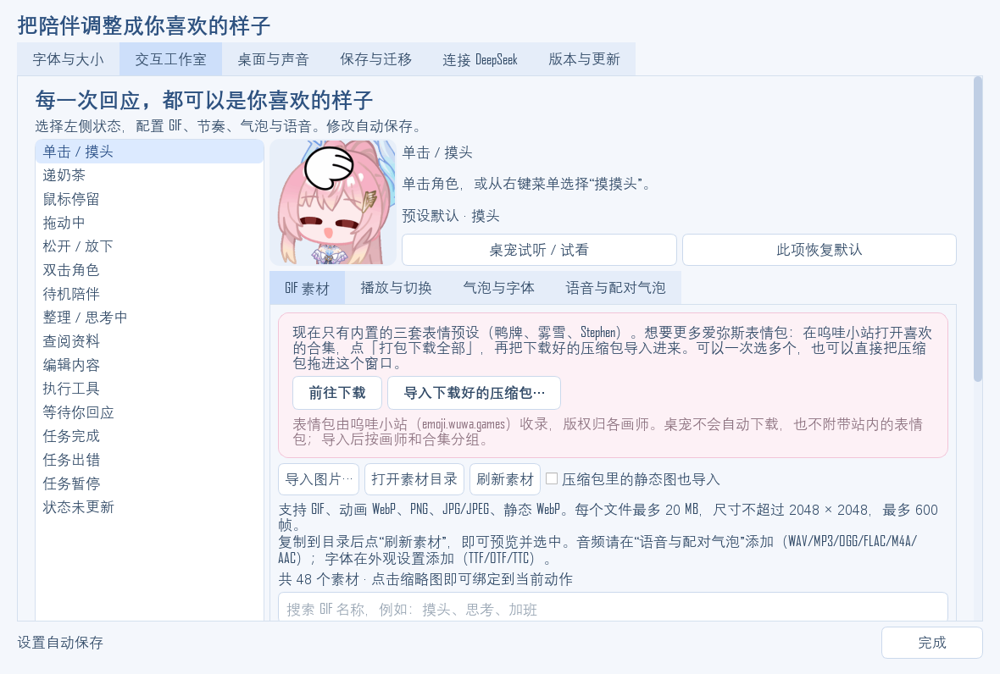
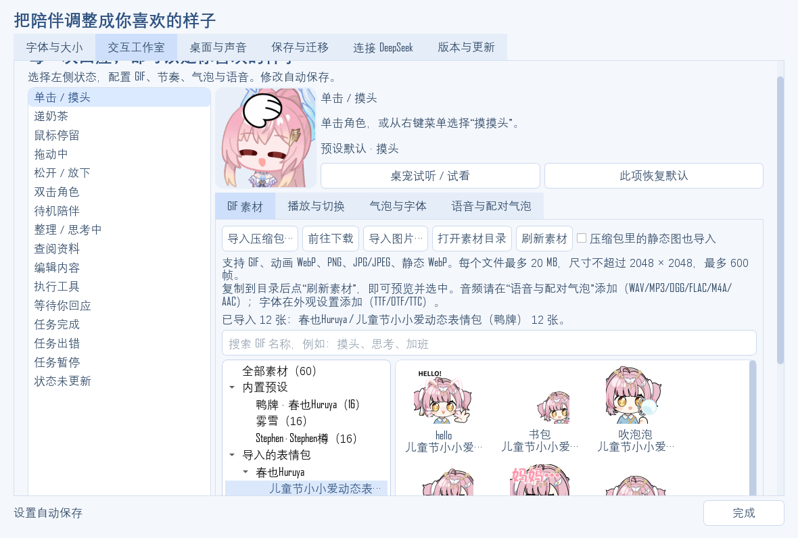
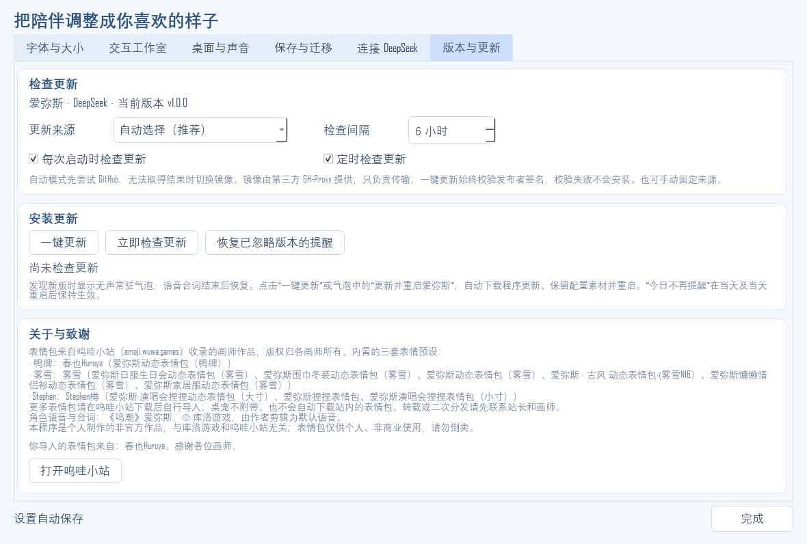

<!-- README language switch -->
[](README.md) [](README.en.md)
<!-- /README language switch -->

<div align="center">

# 爱弥斯 DeepSeek 桌宠

**《鸣潮》爱弥斯陪你使用 DeepSeek Harness：跟随任务切换表情，用她的声音回应你。**

[下载 Windows 版](https://github.com/Doya16/aemeath-deepseek-pet/releases/latest) · [使用指南](docs/USAGE.md) · [问题反馈](https://github.com/Doya16/aemeath-deepseek-pet/issues) · [English](README.en.md)



</div>

让爱弥斯陪你使用 **DeepSeek Harness 官方 Windows 客户端**：任务进行时换表情，完成后用语音和字幕气泡回应，底部显示账户余额，完成时飘字显示这一轮的花费和用时。

适用于 **Windows 10/11 x64**。完整包附带 **三套表情预设（鸭牌、雾雪、Stephen）、90 条带字幕的爱弥斯语音**、两款字体和 Harness 连接插件。更多爱弥斯表情包可以从 [呜哇小站](https://emoji.wuwa.games/archives?character=爱弥斯) 下载后一键导入。无需安装 Python。

## 安装方法

**系统要求**：Windows 10（1809 及以后）或 Windows 11，64 位；Windows 7 / 8 无法运行。需要先安装官方 **DeepSeek Harness** 桌面客户端，并登录、打开过一次。

1. 打开 [Releases](https://github.com/Doya16/aemeath-deepseek-pet/releases/latest)，下载 **Aemeath-DeepSeek-Windows-v1.0.0.zip**。
2. 解压：右键压缩包 →「全部解压缩」，或用 7-Zip / WinRAR 选「解压到 Aemeath-DeepSeek-Windows-v…\」（和压缩包同名的文件夹）。
   - 不要选「解压到当前文件夹」：压缩包里没有外层文件夹，文件会散在下载目录里。
   - 不要解压到 `C:\Program Files` 这类不能写入的位置，也不要在压缩软件里直接双击运行。
3. 进入解压出来的文件夹，双击 **一键部署.cmd**。它会检查文件，提示你**完全退出** Harness（托盘图标右键 → 退出，登录状态会保留）后安装 Harness 连接插件，创建桌面和开始菜单快捷方式，然后启动爱弥斯。
4. 重新打开 Harness，开始任务。桌宠自动跟随最近活动的会话，同步状态和余额。

暂时不想退出 Harness 时，可以在提示处输入 `S` 跳过插件，之后再运行一次「一键部署.cmd」，或在 **设置 → 连接 DeepSeek → 安装 / 更新 Harness 连接插件** 中安装。无需填写 API Key。

**如果被系统或安全软件拦下：** 弹出「Windows 已保护你的电脑」时，点「更多信息」→「仍要运行」。程序没有购买商业代码签名，所以 Windows 会这样提示。安全软件拦截时请把这个文件夹加入信任区；全部源码公开在本仓库，每个版本的发布页都附有 SHA256SUMS 校验文件。

以后有新版本，桌宠会自己提示，点 **更新并重启爱弥斯** 即可一键更新，设置和素材都会保留。声音默认开启，音量为 10%，在「设置 → 桌面与声音」中调整或关闭。

## 三套表情预设

| 预设 | 画师 | 来源合集 |
| --- | --- | --- |
| **Stephen**（默认） | Stephen樽 | 爱弥斯·演唱会捏捏动态表情包（大寸）等捏捏表情包 |
| **鸭牌** | 春也Huruya | 爱弥斯动态表情包（鸭牌） |
| **雾雪** | 雾雪 | 爱弥斯动态表情包（雾雪）、日服生日会、围巾冬装、慵懒情侣衫、家居服、古风 |

每套预设都给 16 种交互配好了 16 张互不相同的表情：

| 鼠标互动 | 任务状态 | 其他 |
| --- | --- | --- |
| 单击摸头、双击、鼠标停留、拖动中、松开放下、递奶茶 | 思考、查阅资料、编辑内容、执行工具、等待你回应、任务完成、任务出错、任务暂停 | 待机陪伴、状态未更新 |

在 **设置 → 桌面与声音 → 表情预设** 切换。三套预设共用同一组语音；在交互工作室里单独换过表情的动作，切换预设后保持你的选择。



## 更多表情包：从呜哇小站导入

桌宠只附带上面三套预设。爱弥斯的其他表情包收录在 [呜哇小站](https://emoji.wuwa.games/archives?character=爱弥斯)，下载后导入即可：

1. **设置 → 交互工作室 → GIF 素材**，点 **前往下载**，在浏览器里打开喜欢的合集，点 **打包下载全部**。
2. 点 **导入下载好的压缩包…**（可以一次选多个），或者直接把压缩包拖进设置窗口。
3. 导入的表情按 **画师 → 合集** 分组；点缩略图即可绑定到当前动作。

| 还没导入时 | 导入之后 |
| --- | --- |
|  |  |

- 按图片内容识别画师、合集和动作名，例如 `001-XXS01_喇叭.gif` 显示为「喇叭」；新合集用压缩包名作合集名。
- 静态图和不是爱弥斯的图片默认跳过（可勾选导入静态图）；和预设相同、或已经导入过的图片不会重复复制。
- 导入的表情包保存在程序目录的 `assets/imported/`，一键更新不会动它们；选中合集点 **删除这个合集** 即可删除。
- 桌宠不附带、也不会自动下载站内的表情包。表情包版权归各画师，转载或二次分发请先联系站长和画师。

## 语音与字幕

- **90 条爱弥斯语音**，按 16 种交互配好，每条都有字幕；同一动作有多条时随机抽取。
- **台词一旦开始就会说完**：她说话时再点、双击、拖动或递奶茶，动作照常变化，只是不出新声音；动作结束后，这句台词的表情会回来，直到说完。
- **字幕气泡**：角色上方显示台词，默认字体为站酷快乐体；字号、宽度在 **设置 → 字体与大小** 调，也可以直接拖动气泡左右边缘。
- **安静陪伴（静音）**：右键勾选后立即停止声音；取消后恢复原来的音量。
- 每句台词何时开始、何时结束，记录在程序目录的 `voice-log.txt`，反馈“台词没说完”时可以附上。

## 跟随任务、余额与本轮花费

- 任务进行时，表情依次切换为思考、查阅、编辑、执行、等你回应；结束时显示完成、出错或暂停。多个会话的完成提醒依次出现。
- 在 **设置 → 连接 DeepSeek → 跟随的会话** 中选择“自动跟随最近活动”（默认），或固定跟随一个会话。
- 底部余额框显示账户充值与赠送余额合计，悬停看明细；点击余额框或右键 → **刷新余额** 立即重读。
- 任务完成时，角色旁飘出本轮花费（按 token 用量和官方价格估算）和用时，并撒彩色纸屑；样式、顺序和位置都能调整或关闭。

## 桌面陪伴

- **贴边藏起**、**全屏隐藏**、**每日小结**、**喝水和久坐提醒**（爱弥斯递上一杯奶茶，可设“稍后再提醒”的分钟数）。
- **顶部小锁**：锁定后点击穿透到下面的窗口；小锁仍可点。
- **随 Harness 启动 / 退出**：在 **设置 → 连接 DeepSeek** 勾选。
- Windows 音量合成器显示「爱弥斯 · DeepSeek」；托盘提示「爱弥斯 · DeepSeek」。关闭程序：右键 → **关闭爱弥斯**。

## 自定义

右键桌宠 → **设置 → 交互工作室**，先在左侧选一个动作，再为它选表情、播放规则、气泡和语音。支持 GIF、动画 WebP、PNG、JPG/JPEG；语音支持 WAV、MP3、OGG、FLAC、M4A、AAC；字体支持 TTF、OTF、TTC。自带 **霞鹜文楷** 和 **站酷快乐体** 两款字体。

## 一键更新

桌宠启动后在后台检查新版本，默认每 6 小时一次。点击 **更新并重启爱弥斯**，即可完成下载、校验、安装和重启；只更新程序文件，保留表情、语音、导入的表情包和全部个人设置。更新清单由发布者离线密钥签名（Ed25519），签名不对就不会安装。更新来源可选 **自动选择 / GitHub 官方源 / 镜像加速（中国大陆网络）**。如果某次更新说明需要更新连接插件，按提示重新运行「一键部署.cmd」或在连接设置中重装即可。详见 [更新与恢复](docs/UPDATES.md)。

## 保存与换电脑

设置自动保存。在 **设置 → 保存与迁移** 可以导出 **配置与素材包**（ZIP）或 **Windows 便携完整包**。换电脑后安装并登录 Harness，启动桌宠，再在连接设置中安装一次连接插件。Harness 的登录信息和聊天记录不在桌宠包里。

## 适用范围

- 面向官方 Harness 桌面客户端；网页版普通 DeepSeek 聊天不在连接范围。
- 连接插件名为 `dsh-aemeath-pet`，与其他桌宠的连接插件互不影响，可以同时安装。

## 常见问题

**一键部署提示“在压缩包里直接运行”？** 先把整个 ZIP 解压到一个文件夹，再双击里面的「一键部署.cmd」。

**连接插件没装上？** 确认已从托盘完全退出 Harness（不是只关窗口），并且 Harness 至少打开过一次；然后再运行一次「一键部署.cmd」。

**表情没有跟随新任务？** 重新打开 Harness 后开始一个新任务；在「设置 → 连接 DeepSeek」选择「自动跟随最近活动」。

**遇到其他问题？** 到 [Issues](https://github.com/Doya16/aemeath-deepseek-pet/issues) 附上系统版本、Harness 版本、操作步骤和报错截图；台词问题请附上 `voice-log.txt`。

## 素材来源与致谢

表情包来自 [呜哇小站](https://emoji.wuwa.games/) 收录的画师作品：**鸭牌** —— 春也Huruya；**雾雪** —— 雾雪；**Stephen** —— Stephen樽。感谢各位画师创作这些表情包，也感谢呜哇小站整理收录。设置 → 版本与更新 → **关于与致谢** 里列出每套预设用到的合集，以及你导入的表情包的画师。



角色语音来自《鸣潮》爱弥斯的角色语音。角色、表情包图片与原版语音的权利归各自权利人所有（《鸣潮》© 库洛游戏）。本项目为个人制作的同人作品，与库洛游戏和呜哇小站无关。表情包仅供个人、非商业使用，请勿倒卖或用于付费分发。程序依赖及字体的许可不适用于角色素材；详见 [素材说明](assets/CREDITS.txt) 和 [第三方许可](THIRD_PARTY.txt)。

<details>
<summary>从源码运行</summary>

安装 Python 3.12，在项目目录执行：

```powershell
python -m venv .venv
.\.venv\Scripts\python.exe -m pip install -r requirements.txt
.\.venv\Scripts\python.exe -m aemeath_pet
```

程序模块位于 `aemeath_pet/`；连接插件位于 `integrations/deepseek/`；构建、发布和快捷方式工具位于 `tools/`。构建便携版：`.\.venv\Scripts\python.exe -m pip install -r tools/requirements-build.txt`，再运行 `.\.venv\Scripts\python.exe tools/build_portable.py`，输出在 `dist/爱弥斯DeepSeek桌宠/`。运行检查：`.\.venv\Scripts\python.exe -m unittest discover -s tests`；连接插件：在 `integrations/deepseek` 中运行 `node --test`。

</details>
